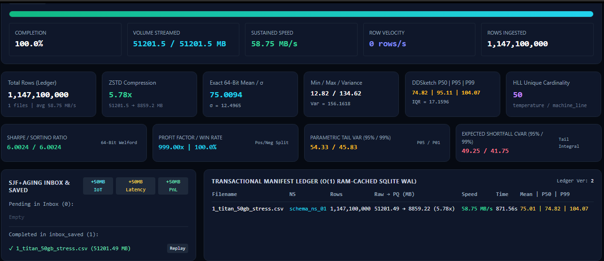
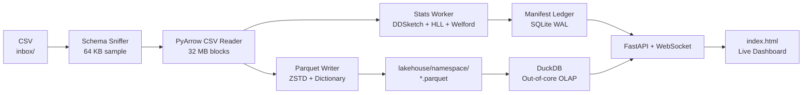

<div dir="rtl" align="right">

# 🏭 Titan Factory — تحلیل ۵۰ گیگابایت CSV در ۱۴ دقیقه، فقط با CPU

**موتور Streaming برای ingestion، فشرده‌سازی Parquet و محاسبهٔ KPIهای دقیق با حافظهٔ محدود — بدون GPU، بدون Spark و بدون بارگذاری کل فایل در RAM.**

<br>


</div>

---

<div align="center">



<sub>اسکرین‌شات واقعی داشبورد Titan پس از پردازش فایل ۵۱٬۲۰۱٫۵ مگابایتی — خروجی ZSTD با نسبت فشرده‌سازی ۵٫۷۸ برابر</sub>

</div>

---

<div dir="rtl" align="right">

## ⚡ نتیجه در یک نگاه

| متریک | مقدار |
|:--|--:|
| حجم ورودی | **۵۱٬۲۰۱٫۵ مگابایت** (حدود ۵۰ گیبی‌بایت) |
| تعداد ردیف | **۱٬۱۴۷٬۱۰۰٬۰۰۰** |
| زمان پردازش | **۸۷۱٫۵۶ ثانیه** (۱۴ دقیقه و ۳۲ ثانیه) |
| سرعت پایدار | **۵۸٫۷۵ مگابایت بر ثانیه** |
| نرخ ردیف | **۱٬۳۱۶٬۱۴۸ ردیف بر ثانیه** |
| خروجی Parquet | **۸٬۸۵۹٫۲ مگابایت** |
| نسبت فشرده‌سازی | **۵٫۷۸×** |
| میانگین دقیق | **۷۵٫۰۰۹۴** |
| انحراف معیار | **۱۲٫۴۹۶۵** |
| کمینه / بیشینه | **۱۲٫۸۲ / ۱۳۴٫۶۲** |
| واریانس | **۱۵۶٫۱۶۱۸** |
| P50 / P95 / P99 | **۷۴٫۸۲ / ۹۵٫۱۱ / ۱۰۴٫۰۷** |
| IQR | **۱۷٫۱۵۹۶** |
| کاردینالیتی HLL | **۵۰** |
| Sharpe / Sortino | **۶٫۰۰۲۴ / ۶٫۰۰۲۴** |
| Profit Factor / Win Rate | **۹۹۹٫۰۰۰× / ۱۰۰٪** |
| VaR 95٪ / 99٪ | **۵۴٫۳۳ / ۴۵٫۸۳** |
| CVaR 95٪ / 99٪ | **۴۹٫۲۵ / ۴۱٫۷۵** |

> این اعداد از ledger واقعی همان اجرا استخراج شده‌اند؛ تصویر بالا هم خروجی زندهٔ داشبورد در پایان همان پردازش است.

</div>

---

<div dir="rtl" align="right">

## 🎯 این پروژه چه مشکلی را حل می‌کند؟

تحلیل فایل‌های CSV چند ده گیگابایتی معمولاً به یکی از این دو راه ختم می‌شود:

- **بارگذاری کامل در RAM** با pandas — که با ۵۰ گیگابایت داده، ماشین را از پا درمی‌آورد.
- **راه‌اندازی خوشهٔ Spark** — که برای یک فایل روی یک ماشین، پیچیدگی و هزینهٔ زیادی دارد.

Titan Factory مسیر سوم را انتخاب می‌کند: **یک pipeline تک‌نودی، Streaming و کاملاً CPU-based** که فایل را تکه‌تکه می‌خواند، هم‌زمان به Parquet فشرده تبدیل می‌کند و آمار دقیق را با ساختمان‌داده‌های mergeable و حافظهٔ O(1) می‌سازد. نتیجه، فایلی است که بعد از پردازش هم با DuckDB به‌صورت out-of-core قابل کوئری است — بدون اینکه کل داده دوباره در حافظه بار شود.

</div>

---

<div dir="rtl" align="right">

## 🧠 چرا این سرعت ممکن است؟

| تکنیک | تأثیر |
|:--|:--|
| **Streaming با بلوک‌های ۳۲ مگابایتی** | فایل هرگز کامل خوانده نمی‌شود؛ فقط یک پنجرهٔ کوچک در حافظه است. |
| **خواندن متوالی با `O_SEQUENTIAL` در ویندوز** | دسترسی‌های تصادفی حذف و prefetch دیسک فعال می‌شود. |
| **دو worker مستقل** | نوشتن Parquet و محاسبهٔ آمار هم‌زمان انجام می‌شوند؛ CPU و دیسک همدیگر را معطل نمی‌کنند. |
| **صف‌های عمیق ۱۶تایی** | خواننده، نویسنده و محاسبه‌گر با backpressure طبیعی هم‌گام می‌شوند. |
| **ZSTD سطح ۱ + Dictionary Encoding** | فشرده‌سازی سریع با نسبت خوب؛ ستون‌های کم‌کاردینال به‌صورت دیکشنری ذخیره می‌شوند. |
| **Row Groupهای ۱٫۵ میلیون ردیفی** | تعادل بهینه بین اندازهٔ فایل، سرعت نوشتن و سرعت کوئری DuckDB. |
| **آمار O(1) به‌جای نگه‌داشتن داده** | میانگین، واریانس، چندک‌ها و کاردینالیتی بدون ذخیرهٔ مقادیر محاسبه می‌شوند. |
| **Memory Governor** | فقط وقتی مصرف Arrow یا RAM آزاد از حد عبور کند، backpressure اعمال می‌شود؛ در حالت عادی هزینهٔ صفر دارد. |
| **حذف کپی‌های اضافی** | فایل ورودی با rename اتمیک به `inbox_saved` منتقل می‌شود، نه کپی. خروجی هم با `os.replace` نهایی می‌شود. |

</div>

---

<div dir="rtl" align="right">

## 🏗️ معماری



### جریان پردازش

1. **کشف خودکار schema** — ۶۴ کیلوبایت اول فایل خوانده می‌شود تا نوع ستون‌ها، ستون عددی اصلی و ستون دسته‌بندی مشخص شوند.
2. **Namespace خودکار** — بر اساس ترکیب ستون‌ها یک namespace مثل `schema_ns_01` ساخته یا reused می‌شود.
3. **Streaming دو‌مسیره** — هر batch هم‌زمان به نویسندهٔ Parquet و worker آمار فرستاده می‌شود.
4. **Finalize اتمیک** — فایل موقت `.tmp` با `os.replace` به نام نهایی تبدیل می‌شود؛ فایل ورودی به `inbox_saved` می‌رود.
5. **ثبت در ledger** — همهٔ آمار و متادیتا در SQLite با WAL ثبت می‌شود تا داشبورد و API بلافاصله آن را ببینند.
6. **کوئری out-of-core** — DuckDB مستقیم روی فایل‌های Parquet فیلتر و GROUP BY اجرا می‌کند.

</div>

---

<div dir="rtl" align="right">

## 🔬 موتور ریاضی

### ۱. میانگین و واریانس دقیق

- **Welford / Chan** برای merge کردن آمار batchها بدون خطای انباشتی.
- **جمع‌بندی جبران‌شدهٔ Neumaier** برای مجموع‌های مثبت و منفی.
- پشتیبانی کامل از مقادیر **منفی، صفر و مثبت** — مناسب دادهٔ PnL و telemetry.

### ۲. DDSketch علامت‌دار

- خطای نسبی تضمین‌شده با **α = ۰٫۰۰۵**.
- محاسبهٔ P50، P95، P99، IQR، VaR و CVaR از یک ساختار **mergeable**.
- bucketهای مجزا برای مقادیر مثبت، منفی و صفر.

### ۳. HyperLogLog

- **p = ۱۲** و ۴٬۰۹۶ register.
- هش **SplitMix64** قطعی و مستقل از seed.
- تخمین کاردینالیتی ستون دسته‌بندی با خطای کم و حافظهٔ ثابت.

### ۴. KPIهای مالی

از همان آمار O(1) محاسبه می‌شوند:

- **Sharpe / Sortino**
- **Profit Factor / Win Rate**
- **VaR و CVaR** در سطوح ۹۵٪ و ۹۹٪
- **Net Cashflow / Profit Margin / Financial Health**

> در دادهٔ دمایی بنچمارک همهٔ مقادیر مثبت‌اند؛ بنابراین Profit Factor و Win Rate به سقف می‌رسند. برای تحلیل معنادار ریسک، از schema علامت‌دار PnL استفاده کنید.

</div>

---

<div dir="rtl" align="right">

## 🚀 نصب و اجرا

**پیش‌نیاز:** Python 3.10 یا بالاتر

```bash
git clone https://github.com/IMI1998/Analyzing-50-GB-of-CSV-data-in-14.5-minutes-on-a-CPU.git
cd Analyzing-50-GB-of-CSV-data-in-14.5-minutes-on-a-CPU

python -m venv .venv

# Windows
.venv\Scripts\activate

# Linux / macOS
source .venv/bin/activate

pip install -r requirements.txt
python server.py
```

سپس در مرورگر باز کنید:

```text
http://127.0.0.1:8000
```

یا با uvicorn:

```bash
uvicorn server:app --host 127.0.0.1 --port 8000
```

> سرور به‌صورت پیش‌فرض فقط روی `127.0.0.1` گوش می‌دهد. هیچ authenticationای وجود ندارد؛ آن را روی شبکهٔ عمومی expose نکنید.

</div>

---

<div dir="rtl" align="right">

## 📊 استفاده

### ۱. پردازش یک فایل

فایل CSV را داخل `inbox/` بگذارید. سرور به‌صورت خودکار:

- فایل را برای نوشتن کامل شدن بررسی می‌کند (`mtime` و قفل فایل).
- با صف **SJF + Aging** کوتاه‌ترین فایل را اول برمی‌دارد تا فایل‌های بزرگ گرسنه نمانند.
- آن را به Parquet تبدیل می‌کند و در `lakehouse/<namespace>/` می‌نویسد.
- فایل اصلی را به `inbox_saved/` منتقل می‌کند.

### ۲. تولید دادهٔ تست

```bash
# فایل ۵۰ گیبی‌بایتی (۵۱٬۲۰۰ مگابایت)
python generator.py --mb 51200 --schema factory --name 1_titan_50gb_stress.csv

# یک تست سریع ۵۱۲ مگابایتی با schema سفارش‌ها
python generator.py --mb 512 --schema orders --name sample_orders.csv
```

> تولید ۵۰ گیگابایت به حدود **۶۲ گیگابایت فضای آزاد** نیاز دارد (CSV + Parquet). اسکریپت قبل از شروع، فضای دیسک را بررسی و هشدار می‌دهد. فایل‌های دیگر `inbox/` را پاک نمی‌کند.

### ۳. داشبورد

داشبورد شامل این بخش‌هاست:

- پیشرفت زندهٔ Streaming، سرعت، ETA، نرخ ردیف و وضعیت stage
- تلمتری سخت‌افزار: CPU، RAM، Swap، حافظهٔ Arrow و RSS فرآیند
- KPIهای آماری و مالی
- صف `inbox` و فایل‌های `inbox_saved`
- جدول ledger با تاریخچهٔ فایل‌ها
- کاوشگر OLAP روی Parquet با فیلتر حدی
- دکمه‌های Replay، Compact و تولید CSV مصنوعی

</div>

---

<div dir="rtl" align="right">

## 🔌 API

| Method | مسیر | توضیح |
|:--|:--|:--|
| `GET` | `/` | داشبورد HTML |
| `GET` | `/api/state` | snapshot کامل وضعیت (hardware، progress، queue، ledger) |
| `GET` | `/api/kpis` | KPI همهٔ namespaceها |
| `GET` | `/api/kpis/{namespace}` | KPI یک namespace |
| `GET` | `/api/query/{namespace}?min_val=...` | کوئری DuckDB روی Parquet با فیلتر حدی |
| `POST` | `/api/compact/{namespace}` | merge کردن فایل‌های کوچک Parquet |
| `POST` | `/api/replay/{filename}` | برگرداندن فایل از `inbox_saved` به `inbox` |
| `POST` | `/api/generate/{size_mb}/{schema_type}` | تولید CSV مصنوعی (`schema_a`، `schema_b`، `schema_c`) |
| `WS` | `/ws` | به‌روزرسانی زندهٔ داشبورد هر ۰٫۵ ثانیه |

</div>

---

<div dir="rtl" align="right">

## ⚙️ تنظیمات

| متغیر محیطی | پیش‌فرض | توضیح |
|:--|:--|:--|
| `TITAN_BASE_DIR` | پوشهٔ پروژه | ریشهٔ `inbox`، `lakehouse` و `manifest.db` |
| `TITAN_SEQ_SCAN` | `1` | فعال‌سازی خواندن متوالی ویندوز |
| `TITAN_ARROW_BUDGET_MB` | `min(4096, 28% RAM)` | سقف حافظهٔ Arrow قبل از backpressure |
| `TITAN_MIN_AVAIL_GB` | `1.0` | حداقل RAM آزاد قبل از توقف موقت |
| `TITAN_ARROW_POOL` | `system` | نوع memory pool پیکان |

مثال:

```bash
# ویندوز (PowerShell)
$env:TITAN_BASE_DIR = "D:\titan_data"
$env:TITAN_ARROW_BUDGET_MB = "2048"
python server.py
```

</div>

---

<div dir="rtl" align="right">

## 📁 ساختار پروژه

```text
.
├── engine.py           # موتور Streaming، نویسندهٔ Parquet، آمار و کوئری
├── server.py           # FastAPI، WebSocket، صف SJF+Aging و APIها
├── telemetry_math.py   # DDSketch، HLL، Welford و ManifestLedger
├── index.html          # داشبورد زندهٔ تک‌صفحه‌ای
├── generator.py        # تولیدکنندهٔ CSV مصنوعی برای تست فشار
├── assets/
│   └── benchmark.png   # تصویر بنچمارک
├── requirements.txt
├── LICENSE
├── .gitignore
├── .gitattributes
├── .editorconfig
└── README.md
```

پوشه‌ها و فایل‌های زیر در زمان اجرا ساخته می‌شوند و عمداً در Git نیستند:

```text
inbox/          inbox_saved/     inbox_failed/
quarantine/     lakehouse/       manifest.db
```

</div>

---

<div dir="rtl" align="right">

## 🧪 بازتولید بنچمارک

بنچمارک روی یک ماشین ویندوزی اجرا شده است: **ورودی روی HDD و خروجی Parquet روی SSD**. برای بازتولید:

1. فضای کافی آزاد کنید (حدود ۶۲ گیگابایت برای CSV + Parquet).
2. فایل تست را بسازید:

   ```bash
   python generator.py --mb 51200 --schema factory --name 1_titan_50gb_stress.csv
   ```

3. سرور را اجرا کنید:

   ```bash
   python server.py
   ```

4. داشبورد را در `http://127.0.0.1:8000` باز کنید و منتظر بمانید تا stage به `COMPLETED` برسد.
5. اعداد نهایی را از کارت‌های داشبورد و جدول ledger بخوانید.

> سرعت واقعی به دیسک، CPU، RAM، فایل‌سیستم، آنتی‌ویروس و اندازهٔ رکوردها بستگی دارد. عدد ۵۸٫۷۵ مگابایت بر ثانیه، نتیجهٔ همان سخت‌افزار و همان فایل است؛ نه یک وعدهٔ ثابت.

</div>

---

<div dir="rtl" align="right">

## ⚠️ محدودیت‌ها

- **تک‌نودی است**؛ برای پردازش توزیع‌شده طراحی نشده است.
- **گلوگاه اصلی دیسک است**؛ روی NVMe سریع‌تر و روی HDD کندتر خواهد بود.
- تشخیص ستون عددی و دسته‌بندی **heuristic** است؛ نام‌هایی مثل `temperature`، `latency_ms`، `price_usd`، `value`، `amount`، `metric`، `score` و `pnl` در اولویت‌اند.
- KPIهای مالی روی دادهٔ همه‌مثبت، تفسیر محدودی دارند؛ برای VaR/CVaR معنادار از دادهٔ PnL علامت‌دار استفاده کنید.
- داشبورد از Tailwind CDN استفاده می‌کند؛ برای اجرای کاملاً آفلاین باید CSS محلی شود.
- هیچ لایهٔ authentication یا rate limiting وجود ندارد؛ پیش‌فرض `127.0.0.1` امن‌ترین حالت است.

</div>

---

<div dir="rtl" align="right">

## 📄 مجوز

این پروژه تحت مجوز **MIT** منتشر شده است. جزئیات در فایل [LICENSE](LICENSE) آمده است.

<br>

**ساخته‌شده با PyArrow، DuckDB، FastAPI و کمی ریاضیات عددی — برای اینکه ۵۰ گیگابایت داده، ماشین شما را از پا نیندازد.**

</div>
